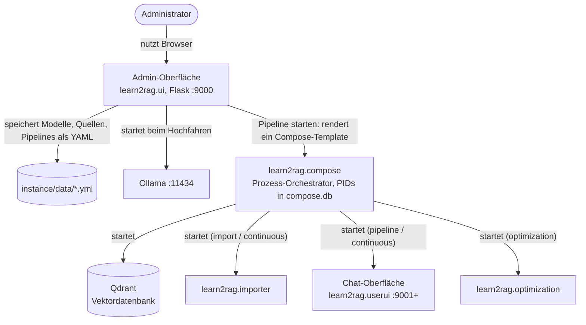
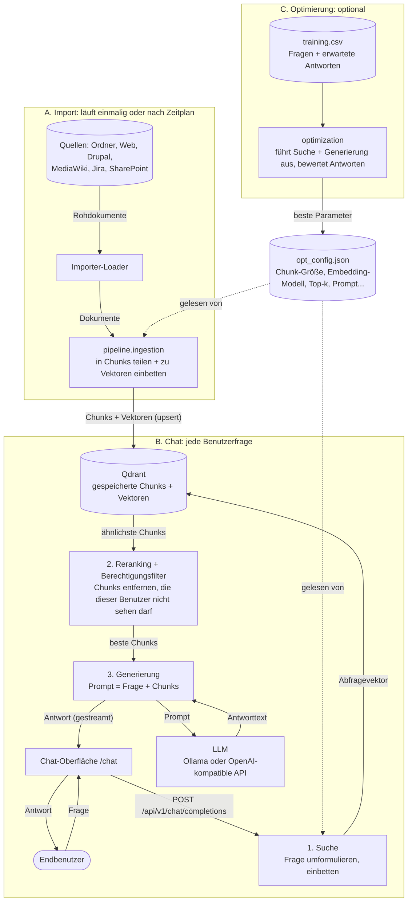

# Architektur

## Was es ist

Learn2RAG ist ein selbst gehostetes RAG-System (Retrieval-Augmented Generation). Ein Administrator registriert über eine Web-Oberfläche (den „Konfigurator“) Sprachmodelle, Datenquellen (lokale Ordner, Websites, Drupal, MediaWiki, Jira, SharePoint) und Pipelines. Jede Pipeline läuft dann als kleine Gruppe lokaler Prozesse: ein Importer, der Dokumente in eine Qdrant-Vektordatenbank indexiert, und eine Chat-Oberfläche, in der Endbenutzer Fragen stellen und Antworten erhalten, die auf diesen Dokumenten basieren. Docker wird nicht benötigt. Alles läuft als einfache Prozesse, die aus einer einzigen ausführbaren Datei gestartet werden.

Benutzerdokumentation: https://docs.learn2rag.de/

## Gesamtbild

Es gibt zwei Diagramme, weil zwei verschiedene Dinge passieren: Zuerst werden Prozesse **gestartet**, dann **fließen Daten** durch sie hindurch.

### 1. Wer startet was

Ein Pfeil bedeutet „startet diesen Prozess“. Hier werden keine Daten übertragen.

Welche Prozesse laufen, hängt vom gewählten Template ab: **pipeline** startet Qdrant und die Chat-Oberfläche, **import** startet Qdrant und einmalig den Importer, **continuous** startet Qdrant, den Importer (alle N Stunden) und die Chat-Oberfläche, und **optimization** startet Qdrant und den Optimierer.

### 2. Wie Daten fließen

Ein Pfeil bedeutet „Daten bewegen sich in diese Richtung“. Von oben nach unten gelesen: Der Importer befüllt Qdrant (A), die Frage eines Benutzers liest daraus (B), und die Optimierung stimmt die Einstellungen ab, die beide verwenden (C).

Nach einem Import gehen die Daten nicht von selbst irgendwohin. Sie bleiben in Qdrant, bis ein Benutzer eine Frage stellt. Die Suche liest sie dann wieder aus, und nur die wenigen am besten passenden Chunks werden zusammen mit der Frage an das LLM gesendet.

## Hauptmodule

Der gesamte Python-Code liegt unter `learn2rag/`.

| Modul | Verantwortung |
|---|---|
| `__main__.py` | **Launcher.** Jeder Prozess startet als `configurator <module> [args]`. Er liest `config.yml` aus dem Arbeitsverzeichnis, richtet das Logging ein, importiert das Modul, baut die Argumente dieses Moduls auf und ruft `module.main(...)` auf. Mit `--schedule-interval` ruft er `main` wiederholt per Timer auf (APScheduler). Der kontinuierliche Import nutzt das. Standard ist `learn2rag.ui`. |
| `ui/` | **Admin-Oberfläche** (Flask, serverseitig gerendertes Jinja + htmx, Deutsch/Englisch über Babel). CRUD für Modelle, Quellen und Pipelines. Beim Starten einer Pipeline wird ein Compose-Template gerendert und an `compose` übergeben. Beim Hochfahren startet sie außerdem Ollama. |
| `ui/templates/compose/` | **Prozess-Templates** (mit Jinja gerendertes YAML). `pipelines/pipeline.yml` (nur Chat), `import.yml` (einmaliger Import), `continuous.yml` (geplanter Import + Chat), `optimization.yml`. `components/ollama*.yml` starten Ollama oder laden ein Modell herunter. |
| `data/` | Minimale Persistenzschicht: Jedes Modell, jede Quelle und jede Pipeline ist eine YAML-Datei unter `<instance>/data/<category>/<uuid>.yml`. |
| `compose/` | **Prozess-Orchestrator**, ein minimales docker-compose für lokale Prozesse. Er schreibt die in einem Template aufgeführten Dateien, startet `services` (Befehl, Umgebung, Arbeitsverzeichnis), führt curl-Healthchecks aus und verfolgt PIDs und Status in SQLite (`compose.db`). Unterstützt POSIX-Prozessgruppen und Windows. |
| `importer/` | **Ingestion-Job.** Er liest `importer_config.json`, führt pro Quelle einen Loader aus (`loaders/*.py`) und übergibt die Dokumente an `pipeline.ingestion`. Im `--delta`-Modus führt er `import_state.json` (Hashes und Zeitstempel) und indexiert nur geänderte Dokumente neu. |
| `pipeline/` | **RAG-Kern.** Umfasst Chunking und Ingestion, Embeddings (sentence-transformers / BGE-M3: dense, sparse, ColBERT), den Qdrant-Client, Query-Umformulierung, Suche mit Reranking, quellenspezifische Berechtigungsfilter (Drupal, SharePoint), Generierung mit LangChain-Chatmodellen (`llm.py`) sowie Provenienz- und Profiling-Logs (`prov.py`). `operators/` setzt diese zu asynchronen Schritten zusammen. `BasicPipeline` = `SearchOperator` → `GenerationOperator`. `api.py` stellt das über HTTP bereit. |
| `userui/` | **Chat-App für Endbenutzer** (FastAPI + uvicorn). Sie bindet `pipeline.api` unter `/api` ein, liefert die llama.cpp-Weboberfläche als statische Dateien unter `/chat` aus und bietet OAuth-Login (`auth/`), damit die Pipeline Ergebnisse danach filtern kann, was jeder Benutzer sehen darf. |
| `optimization/` | Hyperparameter-Tuning von `opt_config.json` (Retrieval-, Prompt- und kontrastive Strategien, SMAC/ConfigSpace, bert-score) anhand einer vom Administrator hochgeladenen Frage-Antwort-Trainings-CSV. |
| `bootstrap/` | Gemeinsames Bootstrap-CSS, Bilder und Basis-Templates für beide Oberflächen. |
| `ollama_tool.py`, `download_models.py` | Hilfsprogramme zum Herunterladen von Ollama-Modellen und zum Vorab-Download von Embedding- und Reranker-Modellen. |
| `evaluation/` | Offline-Evaluationsskripte. Werden zur Laufzeit nicht verwendet. |

Außerhalb von `learn2rag/`:
- `services/`: Qdrant-, Ollama- und llama.cpp-Binärdateien sowie deren Installationsskripte. `services/llama.cpp` ist ein Submodul; seine gebaute Weboberfläche ist das, worin Endbenutzer chatten.
- `drupal/`, `mediawiki/`: docker-compose-Testinstanzen dieser Quellen.
- `ansible/`, `systemd/`: Server-Deployment.
- `pyapp/`, `package-*`, `build-python`: bauen die einzelne `configurator`-Binärdatei für Release-Bundles.

## Wie die Teile zusammenhängen

### 1. Administrator konfiguriert und startet eine Pipeline
1. Der Administrator legt ein **Modell** an (ein Ollama-Modell zum Herunterladen oder URL, Token und Modellname für eine OpenAI-kompatible API), eine oder mehrere **Quellen** und eine **Pipeline**, die ein Modell mit Quellen und einem Speicherverzeichnis verknüpft. Alles wird über `learn2rag.data` als YAML gespeichert.
2. Beim „Start“ führt `start_pipeline()` in `ui/__init__.py` Folgendes aus:
    - erzeugt den Inhalt von `importer_config.json` aus den ausgewählten Quellen (Zuordnung `local` → `DirectoryLoader`, `web` → `HTMLLoader` usw.),
    - wählt freie Ports (`find_free_ports`, bevorzugt 9001–9010),
    - erzeugt einen zufälligen Qdrant-API-Schlüssel,
    - rendert das gewählte Compose-Template mit diesem Kontext und ruft `compose.Project.create(...).start()` auf.
3. `compose` schreibt die Konfigurationsdateien in das Speicherverzeichnis der Pipeline und startet jeden Dienst. Jeder Dienstbefehl ruft dieselbe ausführbare Datei auf, zum Beispiel `configurator learn2rag.userui --port 9001 ...`.

### 2. Import (Indexierung)
`configurator learn2rag.importer --config importer_config.json --delta`. Die Loader holen Dokumente aus den Quellen, dann teilt `pipeline.ingestion.index` sie in Chunks, bettet sie ein und schreibt sie per Upsert in die Qdrant-Collection. Eine kontinuierliche Pipeline führt denselben Befehl mit `--schedule-interval PT<n>M` aus (standardmäßig alle 12 h).

### 3. Abfrage (Chat)
1. Der Browser lädt die llama.cpp-Oberfläche von `/chat`. Diese Oberfläche ruft die relativen Pfade `v1/models` und `v1/chat/completions` auf. Eine Middleware (`PrefixRewriteMiddleware`) schreibt diese von `/chat/...` auf `/api/...` um.
2. `pipeline/api.py` empfängt eine Chat-Anfrage im OpenAI-Format und führt `BasicPipeline` aus:
    - **Suche**: Frage optional anhand des Chatverlaufs umformulieren, einbetten, Qdrant abfragen, Reranking durchführen und dann Dokumente entfernen, auf die der Benutzer keinen Zugriff hat (`authorization.py` mit den quellenspezifischen Filtern, anhand der in der Benutzersitzung gespeicherten OAuth-Tokens).
    - **Generierung**: einen Prompt mit dem abgerufenen Kontext erstellen und das konfigurierte LLM aufrufen.
3. Die Antwort wird als JSON zurückgegeben oder als Server-Sent Events gestreamt. Profiling- und Provenienzzeilen werden in `<storage>/logs/profiling.log` geschrieben.

## APIs und externe Dienste

**Bereitgestellte HTTP-Endpunkte**

| Prozess | Endpunkt | Zweck |
|---|---|---|
| Admin-Oberfläche (`:9000`) | `/`, `/models`, `/sources`, `/pipelines`, `/pipelines/<name>`, `/pipelines/<name>/logs/<file>`, `/pipelines/<name>/training`, `/ps`, `/shutdown` | HTML-Seiten und Formular-POSTs |
| Chat-Oberfläche (`:9001+`) | `GET /` | Startseite mit OAuth-Login-Schaltflächen |
| | `/chat/*` | llama.cpp-Weboberfläche (statisch), plus `/chat/props` |
| | `GET /api/v1/models` | Liefert ein einzelnes Modell, `Learn2RAG` |
| | `POST /api/v1/chat/completions` | OpenAI-kompatibler Chat, gestreamt oder nicht |
| | `POST /api/v1/stream` | Streaming-Variante |
| | `/auth/oauth/{login,callback,logout}` | OAuth-Login gegen eine Quelle (Drupal, SharePoint) |

**Ausgehende Aufrufe**

| Aufgerufener Dienst | Von | Konfiguration |
|---|---|---|
| LLM (Ollama oder OpenAI-kompatibel) | `pipeline/llm.py` über LangChain `ChatOllama` / `ChatOpenAI` | `LLM_API_TYPE`, `LLM_API_URL`, `LLM_API_TOKEN`, `LLM_API_MODEL`, `LLM_API_PROXY` |
| Ollama-Verwaltung (auflisten, herunterladen) | `ui/__init__.py` über den `ollama`-Client | `OLLAMA.port` in `config.yml` (Standard 11434) |
| Qdrant | `pipeline/qdrant.py` | `QDRANT_LOCATION` (URL) oder `QDRANT_PATH` (eingebettet, auf der Festplatte), plus `QDRANT__SERVICE__API_KEY` |
| Datenquellen | `importer/loaders/*` | Quellenspezifische Einstellungen (URLs, Zugangsdaten, OAuth-Client) in `importer_config.json`. Jira kann auch `JIRA_USERNAME` / `JIRA_API_TOKEN` verwenden. |
| Berechtigungsprüfungen (Drupal, SharePoint / MS Graph) | `pipeline/authorization_*.py` | Verwendet das OAuth-Token des Endbenutzers aus der Sitzung |
| Hugging-Face-Modelle (Embeddings, Reranker) | `pipeline/embeddings.py`, `search.py`, `download_models.py` | Modellnamen in `opt_config.json` |

**Authentifizierung**
- Admin-Oberfläche: optionale HTTP-Basic-Auth über `SIMPLE_AUTH: {username, password}` in `config.yml`. Standardmäßig lauscht sie nur auf 127.0.0.1.
- Chat-Oberfläche: optionale Basic-Auth (`CHAT.username/password`, ersatzweise `SIMPLE_AUTH`), übergeben als `--basic-username/--basic-password`. OAuth-Anwendungen werden automatisch aus Quellen erkannt, die eine `oauth_client_id` und ein Client-Secret haben. Nach dem Login wird das Token in der Sitzung gespeichert und verwendet, um Suchergebnisse pro Benutzer zu filtern.
- TLS für beide Oberflächen: `TLS: {CERTFILE, KEYFILE}` in `config.yml`.

## Konfiguration und Umgebungsvariablen

**Konfiguration auf Administratorebene (YAML, geschichtet):**
1. `learn2rag/ui/config.yml`: eingebaute Standardwerte wie `SUGGESTED_MODELS`. Benutzer bearbeiten diese Datei nicht.
2. `config.yml` im Arbeitsverzeichnis (neben der ausführbaren Datei): Benutzer-Overrides, die darüber gelegt werden. Wichtigste Schlüssel: `UI` (`host`, `port`), `CHAT` (`host`, `username`, `password`, `forwarded-allow-ips`), `SIMPLE_AUTH`, `TLS`, `OLLAMA.port`, `PREFERRED_PORTS`, `logging.debug`, `flask.instance_path`.

**Zustand der Admin-Oberfläche:** das Flask-Instanzverzeichnis, standardmäßig das plattformspezifische Datenverzeichnis `Learn2RAG/instance` (z. B. `~/.local/share/Learn2RAG/instance`):
- `data/{models,sources,pipelines}/*.yml`: alles, was der Administrator angelegt hat.
- `storage/<pipeline>/`: Standardspeicher pro Pipeline (Qdrant-Daten, generierte Konfigurationen, Logs).
- `ollama/`: Arbeitsverzeichnis von Ollama.

Der Prozesszustand wird in `compose.db` gespeichert (SQLite, im Arbeitsverzeichnis, sofern `COMPOSE_DB` nicht gesetzt ist).

**Dateien pro Pipeline** (vom Compose-Template in das Speicherverzeichnis generiert):
- `importer_config.json`: die Liste der Loader und Quelleneinstellungen.
- `basic_user_config.json`: Collection-Name und LLM. Wird über `PIPELINE_USER_CONFIG` gelesen.
- `opt_config.json`: abstimmbare Retrieval- und Generierungsparameter (Chunking, Embedding-Modell, Top-k, Reranker, Prompt…), kopiert aus `pipeline/opt_config.json` und von der Optimierung überschrieben. Wird über `PIPELINE_OPT_CONFIG` gelesen. Siehe `pipeline/CONFIG_PARAMS.md`.
- `qdrant_config.yml`, `logging_config.yml`, `logs/{status,error,profiling,debug}.log`.

**Für Pipeline-Prozesse gesetzte Umgebungsvariablen** (siehe `ui/templates/compose/pipelines/*.yml`):
`LEARN2RAG_PATH`, `STORAGE_PATH`, `PIPELINE_USER_CONFIG`, `PIPELINE_OPT_CONFIG`, `IMPORTER_CONFIG`, `QDRANT_LOCATION`, `QDRANT_PATH`, `QDRANT__SERVICE__API_KEY`, `LLM_API_TYPE`, `LLM_API_URL`, `LLM_API_TOKEN`, `LLM_API_MODEL`. `pipeline/config.py` lädt die drei JSON-Konfigurationen beim Import anhand dieser Variablen und greift ersatzweise auf die Kopien in `learn2rag/pipeline/` zurück.
